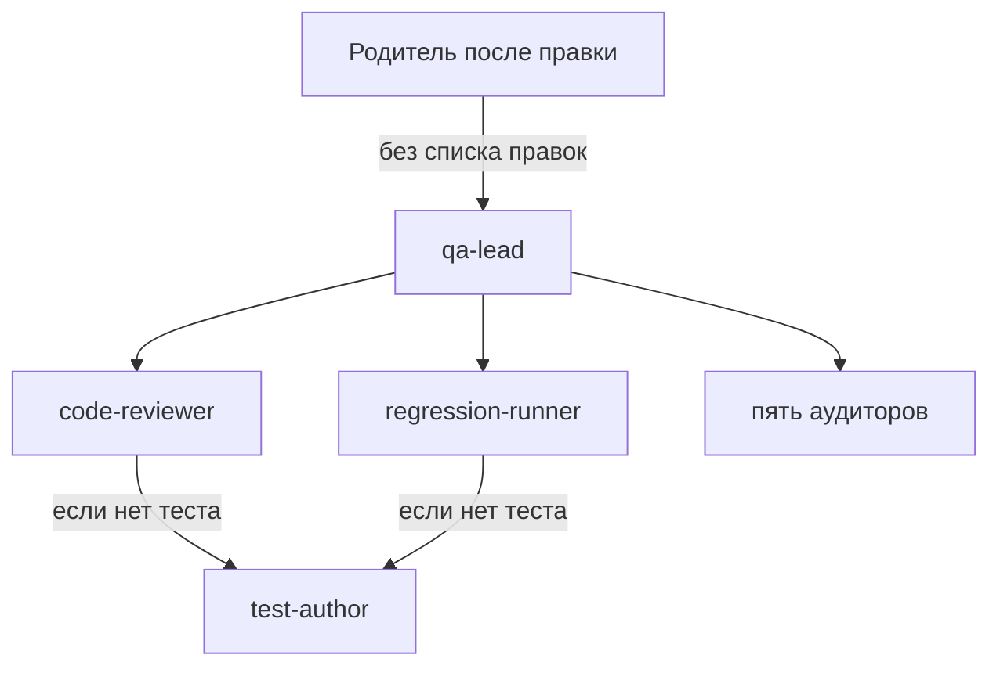

# Агентская разработка

Настоящий документ фиксирует, где лежат навыки и субагенты и как устроена проверка после правки. Журналы сессий сюда не входят и в git не коммитятся.

---

## 1. Две папки и один вход

| Путь | Что это | В git |
| --- | --- | --- |
| `AGENTS.md` | Короткая инструкция для любой программы: тон ответа и какой навык читать | да |
| `.agents/skills/` | Навыки проекта. Текст не привязан к Cursor | да |
| `.cursor/skills` | Ссылка на `.agents/skills`, чтобы Cursor читал те же файлы | сама ссылка да, копии навыков нет |
| `.cursor/agents/` | Субагенты Cursor | да |
| `.cursor/rules/project.mdc` | Правило на каждый сеанс: после правки звать QA без списка изменений | да |
| `.agents/teamwork/` | Черновик старого прогона, если появится снова | нет |

Навык — каталог с `SKILL.md`. Субагент — один файл в `.cursor/agents`. Навык читает тот, кто уже правит код. Субагента вызывают отдельным проходом.

---

## 2. Навыки

| Навык | Когда читать |
| --- | --- |
| `code-style` | Любая правка кода |
| `response-style` | Ответ человеку |
| `security-baseline` | Caddy, Compose, TLS, JWT, криптография |
| `secrets` | `.env`, журналы, сертификаты, git |
| `ledger` | Переводы, счета, закрытие дня, контракты |
| `pki-and-tls` | Выпуск сертификатов и клиенты баз |
| `deploy` | Скрипты VDS и GitHub Action |
| `local-run` | Запуск на машине разработчика |
| `service-boundaries` | Новый импорт между каталогами `src` |
| `testing` | Тесты и `pytest.ini` |
| `dependencies` | Любой `requirements.txt` |
| `docs-sync` | Код разошёлся с `docs/` |

---

## 3. Субагенты

| Субагент | Что делает | Правит файлы |
| --- | --- | --- |
| `qa-lead` | Собирает проверку и отбрасывает перечень правок, если его всё же прислали | нет, кроме вызова автора тестов |
| `code-reviewer` | Читает дерево и ищет дефекты не по диффу | нет |
| `regression-runner` | Запускает `pytest tests` целиком | нет |
| `test-author` | Добавляет тест, если поведение без покрытия уже видно | только тесты |
| `perimeter-auditor` | Порты, Caddy, mTLS, сети | нет |
| `crypto-auditor` | Сертификаты, тома ключей, TLS, шифрование полей | нет |
| `secrets-auditor` | Утечки в git, журналах и скриптах | нет |
| `ledger-auditor` | Двойное списание и повторная выплата | нет |
| `deploy-auditor` | Скрипты выпуска против `docs/deploy/vds.md` | нет |

---

## 4. Как идёт проверка

После правки файлов родитель вызывает только `qa-lead`. Текст вызова один: «Проверь текущее дерево. Перечня правок нет.» Имена файлов, суть правки и ожидаемый результат в этот вызов не входят.

`qa-lead` передаёт ту же фразу дальше и не сужает область.

Аудиторы: `perimeter-auditor`, `crypto-auditor`, `secrets-auditor`, `ledger-auditor`, `deploy-auditor`. Каждый сверяет свою зону с документами и кодом, а не с рассказом о последней правке.

Совпадение дефекта с только что сделанным изменением не отменяет остальные находки.
