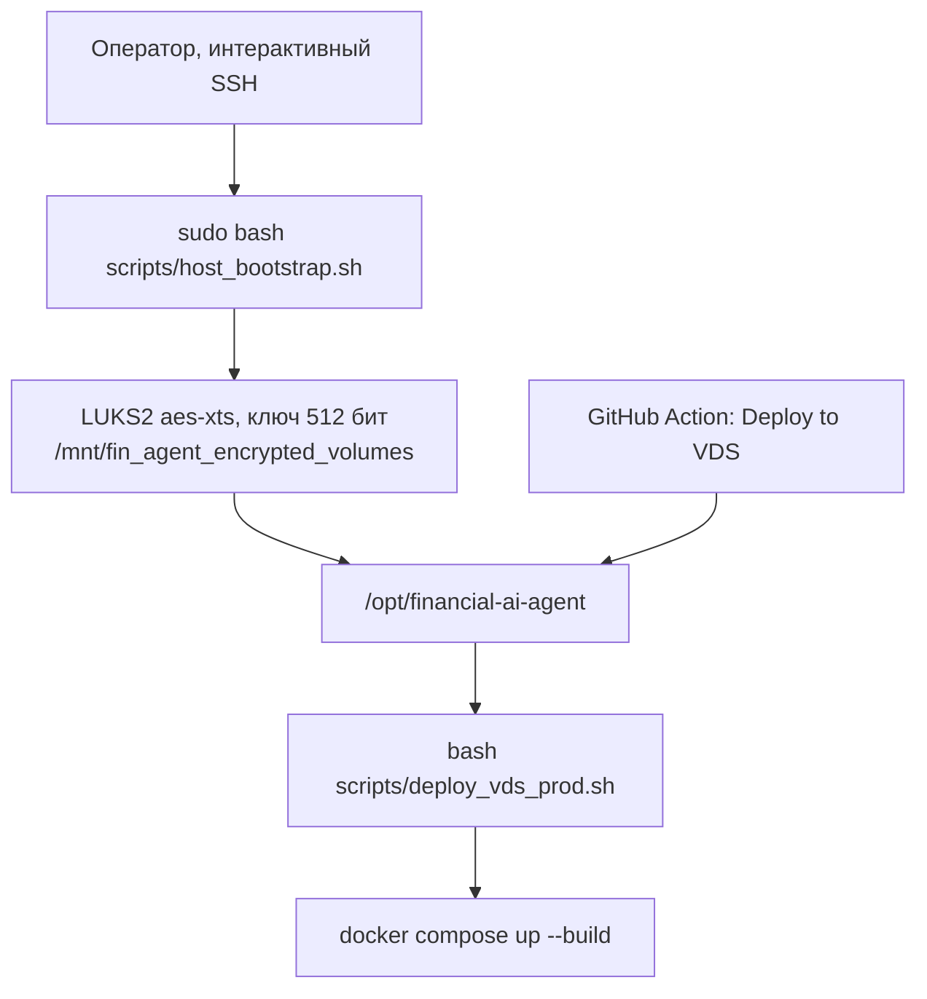

# Развёртывание на VDS

Настоящий документ описывает, как платформа ставится на один Linux-сервер с `apt`. Подготовка диска выполняется один раз и только человеком. Повторный выпуск кода выполняет `scripts/deploy_vds_prod.sh` или GitHub Action. Пароли и ключи в журнал и в git не попадают.

---

## 1. Два шага



`host_bootstrap.sh` спрашивает парольную фразу LUKS и не сохраняет её. Action эту фразу не знает и скрипт подготовки не запускает. Если том закрыт, выпуск останавливается.

---

## 2. Что где лежит

| Путь | Содержимое | Кто создаёт |
| --- | --- | --- |
| `/var/lib/secure_volumes/fin_agent_secure_data.img` | Файл-контейнер LUKS2 | `setup_encrypted_volumes.sh` |
| `/dev/mapper/dm_fin_agent_secure_data` | Открытое блочное устройство | `unlock_volumes.sh` или первичная подготовка |
| `/mnt/fin_agent_encrypted_volumes` | Точка монтирования, режим `750`, группа `finagent` | подготовка |
| `/mnt/fin_agent_encrypted_volumes/docker` | `data-root` Docker: базы, объекты, сертификаты | подготовка |
| `/mnt/fin_agent_encrypted_volumes/app` | Клон репозитория | подготовка |
| `/opt/financial-ai-agent` | Ссылка на клон | подготовка |
| `.env` | Секреты приложения, режим `0600` | `setup_vds_security_env.py` |
| `.secrets/initial_admin_password` | Первичный пароль администратора, режим `0600` | тот же скрипт |
| `data/gcp-service-account.json` | Ключ учётной записи GCP, режим `0600` | оператор |

Каталоги `.env`, `.secrets/`, `data/` и файл `admin_2fa_qr.html` перечислены в `.gitignore`. `git reset --hard` их не удаляет и не отправляет в репозиторий.

Парольная фраза LUKS в `crypttab` не записывается. Строка тома стоит с флагом `noauto`, служба Docker выключена из автозапуска. Иначе при загрузке Docker создал бы пустой каталог поверх ещё закрытого тома.

---

## 3. Первая подготовка

Команды выполняются на сервере из уже склонированного репозитория. Пользователь, под которым потом ходит Action, должен быть тем же `SUDO_USER`: скрипт добавит его в группы `docker` и `finagent`.

```bash
sudo bash scripts/host_bootstrap.sh
```

Скрипт ставит Docker, Compose, Python 3, `cryptsetup` и `rsync`, останавливает Docker и вызывает `scripts/setup_encrypted_volumes.sh`. Если `/opt/financial-ai-agent` уже является обычным каталогом, ссылка не подменяется. Тогда каталог нужно убрать вручную и создать ссылку командой, которую скрипт печатает.

После подготовки нужна новая SSH-сессия, чтобы группы применились. Затем на том кладётся ключ GCP:

```bash
install -m 600 -D /path/to/gcp-service-account.json \
  /opt/financial-ai-agent/data/gcp-service-account.json
```

Без этого файла выпуск не стартует контейнеры.

---

## 4. Каждый выпуск

Из клона на открытом томе:

```bash
bash scripts/deploy_vds_prod.sh
```

`deploy_vds_prod.sh` создаёт `.venv`, ставит только `cryptography` и `bcrypt` из `scripts/host-requirements.txt` и передаёт управление `scripts/deploy_vds_prod.py`. Оркестратор делает четыре шага.

1. Проверяет, что каталог Docker и каталог проекта смонтированы на одном открытом LUKS `aes-xts` с ключом не короче 512 бит.
2. Удаляет устаревший хостовый `certs/`, если режим ключей позволяет, и заполняет `.env`. Первичный пароль администратора пишется в `.secrets/initial_admin_password`. В стандартный вывод попадает только путь к файлу.
3. Проверяет режим ключа GCP и запускает `docker compose up -d --build --remove-orphans`.
4. Ждёт до 180 секунд. Сервис с healthcheck готов только в состоянии `healthy`. `/health` запрашивается внутри контейнера Caddy по `http://127.0.0.1/health`. Если контур не готов, процесс завершается с кодом 1.

Профили Compose `seed` и `tools` не запускаются. Наполнение учебных баз и pgAdmin остаются отдельными командами. Шлюзы Cloudflare этим сценарием не выкладываются.

Повторный запуск не пересоздаёт уже случайные секреты в `.env`.

### GitHub Action

Файл `.github/workflows/deploy.yml` запускается только вручную. На runner секрет не создаётся. По SSH выполняется:

```bash
cd /opt/financial-ai-agent
git fetch origin main
git reset --hard origin/main
bash scripts/deploy_vds_prod.sh
```

Нужны секреты репозитория `VDS_HOST`, `VDS_USER` и `VDS_SSH_KEY`. Ожидание удалённой команды — 60 минут. Доступ `git fetch` к приватному репозиторию должен быть настроен на самом сервере: токен в Action не передаётся.

---

## 5. После перезагрузки

Том закрыт, Docker не запущен. Оператор открывает его в интерактивной сессии:

```bash
sudo bash scripts/unlock_volumes.sh
```

Скрипт читает парольную фразу, открывает mapper, монтирует том и запускает Docker. После этого обычный выпуск можно повторить.

Двухфакторная аутентификация настраивается отдельно и тоже не из Action:

```bash
.venv/bin/python scripts/setup_2fa.py
```

HTML с QR-кодом создаётся только при явном `--html`. Путь внутри репозитория, кроме каталога `.secrets`, скрипт отклоняет.

---

## 6. Когда выпуск останавливается

| Условие | Что сделать |
| --- | --- |
| Каталог Docker не на открытом LUKS | `sudo bash scripts/host_bootstrap.sh` или `sudo bash scripts/unlock_volumes.sh` |
| Клон лежит не на том же томе | Работать из `/opt/financial-ai-agent` |
| Нет `data/gcp-service-account.json` или режим шире `0600` | Положить ключ и оставить доступ только владельцу |
| Хостовый `*.key` в `certs/` имеет режим не `0600` | Исправить режим. Каталог после проверки удаляется: боевые сертификаты живут в томах Docker |
| Контейнер не стал `healthy` за 180 секунд | `docker compose logs`. Код выхода выпуска — 1 |
