# Архитектурная топология 5 подсетей Docker и сквозного шифрования (Zero-Trust PKI)

Настоящий документ содержит детальную схему сетевой микросегментации платформы **Financial-AI-Agent** и протоколы шифрования каналов связи между всеми контейнерами системы.

---

## 1. Диаграмма подсетей и каналов шифрования

```mermaid
flowchart TB
    %% Внешний мир
    subgraph External [" ВНЕШНЯЯ СЕТЬ (ИНТЕРНЕТ / РАБОЧАЯ СТАНЦИЯ) "]
        AdminWorkstation["Рабочая станция Администратора<br/>(Admin Client Desktop)"]
    end

    %% ПОДСЕТЬ 1: edge_net
    subgraph EdgeNet [" ПОДСЕТЬ 1: edge_net (ЕДИНСТВЕННЫЙ ПУБЛИЧНЫЙ INGRESS) "]
        Caddy["caddy (caddy-server)<br/>Порты хоста: 80, 443<br/>• TLS 1.3 / mTLS<br/>• Сертификат платформы из root-ca"]
    end

    %% ПОДСЕТЬ 2: admin_backend_net
    subgraph AdminBackendNet [" ПОДСЕТЬ 2: admin_backend_net (КОНТУР УПРАВЛЕНИЯ) "]
        AdminServer["admin-server<br/>(FastAPI Core, порт 8000)"]
        VectorWorker["vector-worker<br/>(Обработка документов RAG)"]
        RedisServer["redis (redis-server)<br/>TLS порт: 6379 | Plaintext: 0"]
    end

    %% ПОДСЕТЬ 3: simulation_net
    subgraph SimNet [" ПОДСЕТЬ 3: simulation_net (БАНКОВСКИЕ СИМУЛЯЦИИ) "]
        SimAPI["simulation-api<br/>(FastAPI Шлюз, порт 8002)"]
        BankWorker["bank-worker<br/>(EOD закрытие дня)"]
        InvestWorker["invest-worker<br/>(EOD закрытие дня)"]
        DigitalWorker["digital-worker<br/>(EOD цифровой рубль)"]
        SimSeeder["simulations-seeder<br/>(Профиль: seed)"]
    end

    %% ПОДСЕТЬ 4: data_net
    subgraph DataNet [" ПОДСЕТЬ 4: data_net (ПОЛНАЯ ИЗОЛЯЦИЯ: internal: true) "]
        PostgresDB["postgres-db (financial-postgres)<br/>Порт 5432 | SSL: on<br/>Каталог Docker на LUKS"]
        MinioServer["minio (minio-server)<br/>Порт 9000 (S3 API) | HTTPS<br/>Порт 9001 (Console)"]
        ChromaServer["chromadb (chromadb-server)<br/>Порт 8000 | Token Auth"]
        PgAdmin["pgadmin (pgadmin4)<br/>(Интерфейс администрирования БД)"]
    end

    %% ПОДСЕТЬ 5: pki_net
    subgraph PkiNet [" ПОДСЕТЬ 5: pki_net (ROOT CA: internal: true) "]
        RootCA["root-ca (root-ca-service)<br/>• Изолированный офлайн-контейнер<br/>• Выпуск X.509 сертификатов<br/>• restart: no"]
    end

    %% Тома PKI
    subgraph StoragePKI [" ЗАЩИЩЕННЫЕ ТОМА СЕРТИФИКАТОВ "]
        RootCAData[("root_ca_data<br/>Мастер-ключ Root CA<br/>(Только для root-ca)")]
        CertsData[("Выделенные тома сертификатов<br/>admin_certs, bank_certs,<br/>postgres_certs, redis_certs, minio_certs, ca_public")]
    end

    %% Связи Root CA
    RootCA -.->|1. Чтение/запись мастер-ключа| RootCAData
    RootCA -.->|2. Генерация сертификатов при bootstrap| CertsData

    %% Внешний трафик
    AdminWorkstation ==>|"HTTPS (Порт 443)<br/>TLS 1.3 + mTLS (require_and_verify)<br/>Клиентский сертификат X.509"| Caddy

    %% Маршрутизация Caddy -> Бэкенд
    Caddy -->|"Проксирование на admin-server:8000<br/>Заголовки X-Client-Cert-*<br/>(admin_backend_net)"| AdminServer
    Caddy -->|"Внутренний TLS 1.3 (tls internal)<br/>https://simulation-api.internal:443<br/>(simulation_net)"| SimAPI

    %% Межсетевое взаимодействие через Caddy
    AdminServer -.->|"Межсетевой запрос к симуляции<br/>HTTPS TLS 1.3 через Caddy"| Caddy

    %% Взаимодействие внутри admin_backend_net с Redis
    AdminServer ==>|"TLS 1.3 (Порт 6379)<br/>REDIS_SSL=true, CA verify<br/>Пароль REDIS_PASSWORD"| RedisServer
    VectorWorker ==>|"TLS 1.3 (Порт 6379)<br/>REDIS_SSL=true, CA verify"| RedisServer

    %% Взаимодействие с data_net (PostgreSQL)
    AdminServer ==>|"PostgreSQL TLS (Порт 5432)<br/>POSTGRES_SSLMODE=verify-full<br/>Проверка ca.crt"| PostgresDB
    SimAPI ==>|"PostgreSQL TLS (Порт 5432)<br/>POSTGRES_SSLMODE=verify-full<br/>Проверка ca.crt"| PostgresDB
    BankWorker ==>|"PostgreSQL TLS (Порт 5432)<br/>POSTGRES_SSLMODE=verify-full"| PostgresDB
    InvestWorker ==>|"PostgreSQL TLS (Порт 5432)<br/>POSTGRES_SSLMODE=verify-full"| PostgresDB
    DigitalWorker ==>|"PostgreSQL TLS (Порт 5432)<br/>POSTGRES_SSLMODE=verify-full"| PostgresDB
    SimSeeder ==>|"PostgreSQL TLS (Порт 5432)<br/>POSTGRES_SSLMODE=verify-full"| PostgresDB
    PgAdmin ==>|"PostgreSQL TLS (Порт 5432)<br/>SSL: require"| PostgresDB

    %% Взаимодействие с data_net (MinIO S3)
    AdminServer ==>|"HTTPS S3 API (Порт 9000)<br/>MINIO_SECURE=true, TLS<br/>Шифрование MinIO SSE"| MinioServer
    VectorWorker ==>|"HTTPS S3 API (Порт 9000)<br/>MINIO_SECURE=true, TLS<br/>Шифрование SSE-C"| MinioServer

    %% Взаимодействие с data_net (ChromaDB)
    VectorWorker ==>|"HTTP + Token Auth (Bearer)<br/>Сквозное конвертное шифрование<br/>AES-256-GCM в полезной нагрузке"| ChromaServer
```

---

## 2. Матрица межконтейнерного шифрования каналов

В таблице ниже приведены все пары взаимодействующих контейнеров с деталями криптографической защиты:

| Отправитель (Клиент) | Получатель (Сервер) | Сегмент / Подсеть | Протокол и Уровень шифрования | Механизм проверки доверия / Сертификаты |
| :--- | :--- | :--- | :--- | :--- |
| **Admin Client** (Рабочая станция) | **`caddy`** | Интернет $\rightarrow$ `edge_net` | **HTTPS TLS 1.3 / mTLS** | Двусторонняя аутентификация: Caddy проверяет сертификат клиента по `ca.crt` (`require_and_verify`). Клиент проверяет Caddy по корневому сертификату. |
| **`caddy`** | **`admin-server`** | `edge_net` $\rightarrow$ `admin_backend_net` | **HTTP Reverse Proxy с mTLS заголовками** / **TLS 1.3** (`admin-server.internal`) | Caddy терминирует внешний mTLS и передает проверенные метаданные (`X-Client-Cert-Verify`, `X-Client-Cert-Subject`, `Serial`) во внутренний FastAPI. |
| **`caddy`** | **`simulation-api`** | `edge_net` / `admin_backend_net` $\rightarrow$ `simulation_net` | **HTTPS TLS 1.3** (`tls internal`) | Внутренние имена `simulation-api.internal` и `bank-service.internal` обслуживает локальный сертификат Caddy. Публичный вход использует сертификат `root-ca` из `admin_certs`. |
| **`admin-server`** | **`redis`** | Внутри `admin_backend_net` | **Redis TLS 1.3** (Порт `6379`) | `REDIS_SSL=true`. Redis выключает plaintext (`--port 0`), проверяет `ca.crt`. Клиент сверяет сертификат `/certs/redis.crt`. |
| **`vector-worker`** | **`redis`** | Внутри `admin_backend_net` | **Redis TLS 1.3** (Порт `6379`) | `REDIS_SSL=true`. Клиент проверяет доверенный якорь `REDIS_SSL_CA_CERTS=/certs/ca.crt`. |
| **`simulation-api`** | **In-Memory Store / Redis** | Внутри `simulation_net` | **In-Memory TTL Store / Redis TLS** | Потокобезопасное хранилище с защитой от Replay Attacks (атомарная запись Nonce) и мгновенным отзывом сертификатов (CRL). |
| **`admin-server`** | **`postgres-db`** | `admin_backend_net` $\rightarrow$ `data_net` | **PostgreSQL Native TLS** (Порт `5432`) | `ssl=on`, `POSTGRES_SSLMODE=verify-full`. PostgreSQL монтирует `postgres.crt` и `postgres.key`. Клиент сверяет подлинность с `/certs/ca.crt`. |
| **`simulation-api`** | **`postgres-db`** | `simulation_net` $\rightarrow$ `data_net` | **PostgreSQL Native TLS** (Порт `5432`) | `ssl=on`, `POSTGRES_SSLMODE=verify-full`. Защищен от перехвата внутри bridge-моста. |
| **`bank-worker`** | **`postgres-db`** | `simulation_net` $\rightarrow$ `data_net` | **PostgreSQL Native TLS** (Порт `5432`) | `ssl=on`, `POSTGRES_SSLMODE=verify-full`, `SSL_CERT_FILE=/certs/ca.crt`. |
| **`invest-worker`** | **`postgres-db`** | `simulation_net` $\rightarrow$ `data_net` | **PostgreSQL Native TLS** (Порт `5432`) | `ssl=on`, `POSTGRES_SSLMODE=verify-full`, `SSL_CERT_FILE=/certs/ca.crt`. |
| **`digital-worker`** | **`postgres-db`** | `simulation_net` $\rightarrow$ `data_net` | **PostgreSQL Native TLS** (Порт `5432`) | `ssl=on`, `POSTGRES_SSLMODE=verify-full`, `SSL_CERT_FILE=/certs/ca.crt`. |
| **`simulations-seeder`** | **`postgres-db`** | `simulation_net` $\rightarrow$ `data_net` | **PostgreSQL Native TLS** (Порт `5432`) | `ssl=on`, `POSTGRES_SSLMODE=verify-full`, `SSL_CERT_FILE=/certs/ca.crt`. |
| **`pgadmin`** | **`postgres-db`** | Внутри `data_net` | **PostgreSQL Native TLS** (Порт `5432`) | Режим `verify-full` внутри изолированной сети хранения. Профиль Compose `tools`, в обычный запуск не входит. |
| **`admin-server`** | **`minio`** | `admin_backend_net` $\rightarrow$ `data_net` | **HTTPS S3 TLS** (Порт `9000`) | `MINIO_SECURE=true`. MinIO монтирует сертификаты из `/certs/minio`. Плюс серверное шифрование MinIO SSE-KMS. |
| **`vector-worker`** | **`minio`** | `admin_backend_net` $\rightarrow$ `data_net` | **HTTPS S3 TLS** (Порт `9000`) | `MINIO_SECURE=true`. Передача файлов EOD и отчетов защищена TLS + SSE-C шифрованием. |
| **`vector-worker`** | **`chromadb`** | `admin_backend_net` $\rightarrow$ `data_net` | **HTTP + Token Auth + Конвертное шифрование** | Векторная база изолирована флагом `internal: true`. Текстовые чанки и метаданные шифруются на прикладном уровне **AES-256-GCM** перед отправкой в коллекцию. |
| **`root-ca`** | **Сервисы платформы** | `pki_net` $\rightarrow$ выделенные тома | **X.509 PKI Bootstrap** | Контейнер `root-ca` выпускает сертификаты в отдельные тома (`admin_certs`, `bank_certs`, `postgres_certs`, `redis_certs`, `minio_certs`, `ca_public`) и завершается. Том `certs_data` остаётся только у `root-ca`. |

---

## 3. Сводка изоляции процессов и защиты хоста

> [!IMPORTANT]
> **Принцип нулевого доверия к хосту (Host Process Isolation):**
> 1. Ни один из внутренних сервисов (`postgres-db`, `redis`, `minio`, `chromadb`, `admin-server`, `simulation-api`, `pgadmin`) **не публикует порты на сетевых интерфейсах хоста (`127.0.0.1` или `0.0.0.0`)**.
> 2. Любой несанкционированный процесс, запущенный на хост-сервере, физически не может подключиться к портам баз данных или внутреннего API.
> 3. Единственный открытый порт на хосте — это защищенные порты `80` и `443` обратного прокси Caddy, требующие валидного сертификата клиента X.509.
