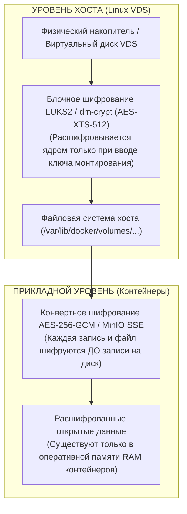
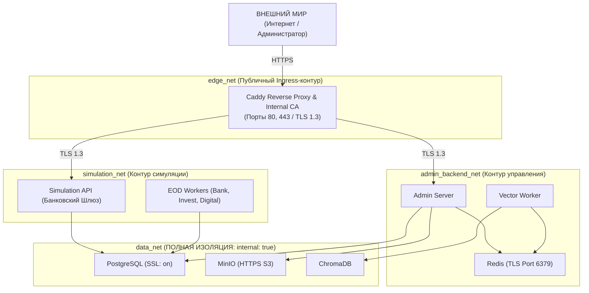
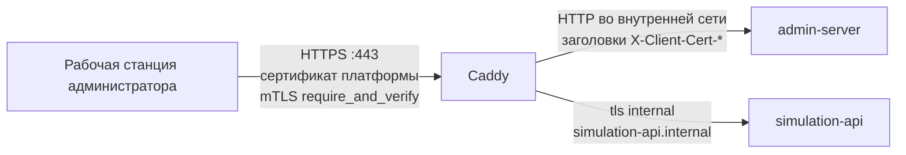
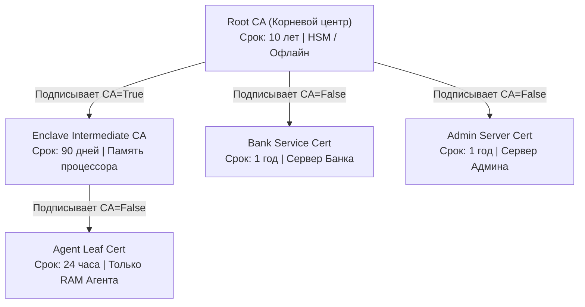
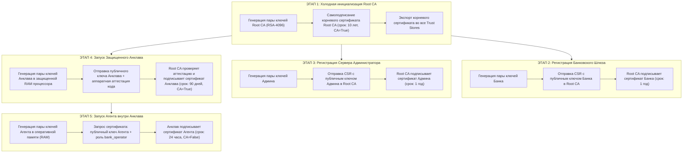
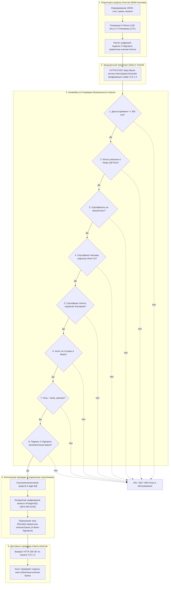
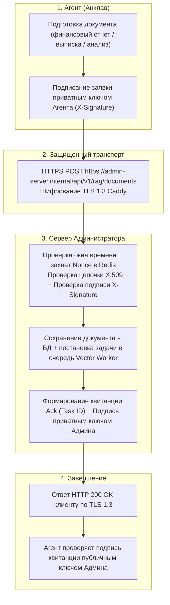
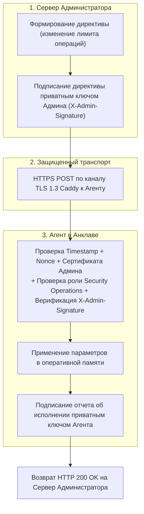
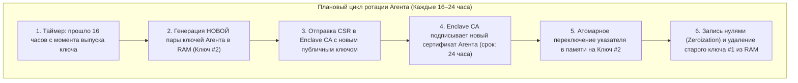
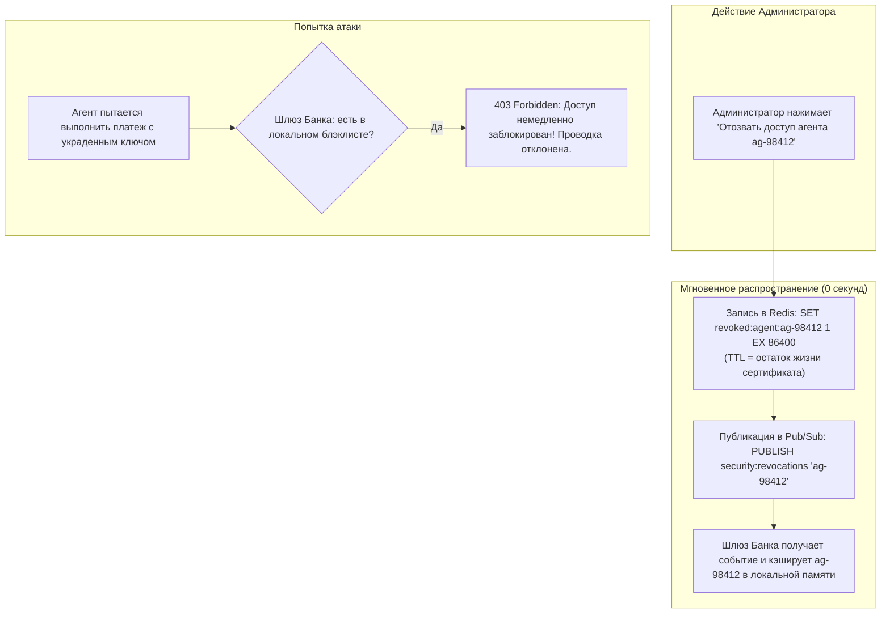

# Архитектурная спецификация: Трехуровневая модель безопасности Zero-Trust

Настоящий документ описывает полную архитектурную модель комплексной защиты финансовой платформы на базе единого VDS-сервера. Архитектура реализует принцип **эшелонированной обороны (Defense-in-Depth)** и гарантирует сквозную безопасность данных во всех трех фундаментальных состояниях:

```
┌─────────────────────────────────────────────────────────────────────────────┐
│                       ТРИЕДИНСТВО ZERO-TRUST БЕЗОПАСНОСТИ                   │
├─────────────────────────────────────────────────────────────────────────────┤
│ 1. ДАННЫЕ В ПОКОЕ (Data at Rest):                                           │
│    Шифрование дисковых томов (LUKS) + Конвертное шифрование (AES-256-GCM)   │
├─────────────────────────────────────────────────────────────────────────────┤
│ 2. ДАННЫЕ В ДВИЖЕНИИ (Data in Transit):                                     │
│    Шифрование межконтейнерных каналов через Caddy Internal CA (TLS 1.3)     │
├─────────────────────────────────────────────────────────────────────────────┤
│ 3. ДАННЫЕ В ОБРАБОТКЕ И ПРИКЛАДНАЯ ИДЕНТИЧНОСТЬ (Data in Use & Identity):   │
│    3-уровневая цепочка X.509 (Root CA -> Enclave CA -> Agent Cert)          │
│    Цифровые подписи запросов (X-Signature), Nonce и изоляция Анклава        │
└─────────────────────────────────────────────────────────────────────────────┘
```

Ни один из уровней не заменяет другие. Даже при полном взломе одного из эшелонов остальные уровни исключают возможность несанкционированного доступа к банковским счетам, финансовым операциям и критическим данным.

---

## ЧАСТЬ I. ШИФРОВАНИЕ ТОМОВ И ДАННЫХ В ПОКОЕ (DATA AT REST)

Этот эшелон гарантирует защиту данных от физической кражи накопителя, создания несанкционированных снимков виртуальной машины (snapshots) хостинг-провайдером, а также прямого чтения секторов диска при выключенном или скомпрометированном сервере.

### 1. Реестр томов проекта и анализ хранимых данных

На основе архитектуры микросервисов проекта выделяются 6 критических персистентных томов, подлежащих обязательному шифрованию:

| Имя тома и путь монтирования | Назначение и хранимые данные | Уровень критичности |
| :--- | :--- | :---: |
| **`root_ca_data`**<br/>`↳ /data/ca` | Выделенный защищенный контейнер Root CA: мастер-приватный ключ Root CA и корневой сертификат. | **КРИТИЧЕСКИЙ**<br/>(Tier-1) |
| **`postgres_data`**<br/>`↳ /var/lib/postgresql/data` | Реляционная база данных PostgreSQL: балансы счетов, история банковских проводок, реестр агентов, хеши паролей, журналы аудита. | **КРИТИЧЕСКИЙ**<br/>(Tier-1) |
| **`redis_data`**<br/>`↳ /data` | Хранилище Redis: оперативный кэш, одноразовые коды запросов (`X-Nonce`), распределенный блэклист отозванных сертификатов и токенов. | **ВЫСОКИЙ**<br/>(Tier-2) |
| **`chroma_data`**<br/>`↳ /chroma/chroma` | Векторная база данных ChromaDB: долгосрочная семантическая память агентов, эмбеддинги финансовых инструкций и профилей клиентов. | **ВЫСОКИЙ**<br/>(Tier-2) |
| **`minio_data`**<br/>`↳ /data` | Объектное хранилище MinIO (S3): отчеты конца дня (EOD), выписки, резервные копии, файлы транзакционных реестров. | **ВЫСОКИЙ**<br/>(Tier-2) |
| **`caddy_data`**<br/>`↳ /data` | Внутреннее хранилище Caddy: приватные ключи внутреннего CA Caddy, выпущенные TLS-сертификаты. | **КРИТИЧЕСКИЙ**<br/>(Tier-1) |

> [!NOTE]
> **Изоляция компонентов:**
> * **Корневой центр сертификации (Root CA):** запускается в изолированном отдельном контейнере со своим зашифрованным томом `root_ca_data`.
> * **Защищенный Анклав:** среда выполнения кода анклава аппаратно изолирована и шифруется процессором на уровне Confidential Computing в защищенной памяти.

---

### 2. Двухуровневая логика шифрования томов

Защита дисковых томов выстроена по принципу «матрешки»: внешнее блочное шифрование операционной системы плюс внутреннее прикладное конвертное шифрование в коде сервисов.



#### Уровень 1: Блочное шифрование файловой системы хоста (LUKS / dm-crypt)
1. **Принцип работы:** вся директория хранения томов Docker (`/var/lib/docker/volumes`) размещается на выделенном блочном разделе Linux, зашифрованном по стандарту **LUKS2 (Linux Unified Key Setup)** с использованием шифра **AES-XTS с размером ключа 512 бит**.
2. **Логика холодного старта хоста:**
   * При физическом включении VDS-сервера зашифрованный раздел заблокирован.
   * Оператор (или доверенный процесс удаленного старта через SSH/TPM) передает ключ разблокировки тома.
   * Ядро Linux открывает виртуальное блочное устройство `/dev/mapper/dm_fin_agent_secure_data`. Парольная фраза не хранится на диске. После перезагрузки том закрыт, пока оператор не выполнит `scripts/unlock_volumes.sh`.
   * Файловая система монтируется, и только после этого демон Docker получает доступ к чтению каталогов томов.
3. **Логика взаимодействия с контейнерами:**
   * Контейнеры монтируют тома стандартным образом. Для PostgreSQL, Redis и ChromaDB файловые операции происходят прозрачно: ядро Linux выполняет аппаратное шифрование и расшифровку секторов диска на лету через инструкции процессора AES-NI.
   * Если виртуальный диск скопирован или прочитан «снаружи» виртуальной машины хостинг-провайдером, все тома представляют собой абсолютно нечитаемый криптографический шум.

#### Уровень 2: Прикладное конвертное шифрование (Application-Level Envelope Encryption)
Блочного шифрования ОС недостаточно, если злоумышленник получит доступ внутрь контейнера или перехватит дамп базы данных (SQL injection, ошибка прав доступа к каталогу). Поэтому данные шифруются в коде приложений:

1. **В реляционной базе данных (`postgres_data`):**
   * Все критические поля (номера счетов, суммы проводок, токены доступа, секреты 2FA) шифруются библиотекой безопасности сервиса **до** отправки в SQL-запрос.
   * Формат зашифрованного пакета: `[4 байта: Магическое число 'ENC1'] + [12 байт: Случайный Nonce] + [Зашифрованные полезные данные + 16 байт Аутентификационный Тег]`.
   * Алгоритм: **AES-256-GCM (Authenticated Encryption with Associated Data)**.
   * Ключ шифрования `DATA_ENCRYPTION_KEY` передается в оперативную память контейнера строго через изолированные переменные окружения и никогда не сохраняется в таблицах базы данных.
2. **В объектном хранилище (`minio_data`):**
   * Включается механизм **серверного шифрования MinIO SSE (Server-Side Encryption with Customer-Provided Keys / SSE-KMS)**.
   * Каждый сохраняемый файл (финансовый отчет, выписка) шифруется своим уникальным разовым ключом данных (DEK), а сам ключ данных шифруется мастер-ключом `MINIO_KMS_SECRET_KEY`.
3. **В векторной базе данных (`chroma_data`):**
   * Текстовые документы и метаданные перед векторизацией и сохранением в коллекциях ChromaDB проходят процедуру конвертного шифрования AES-256-GCM. Векторные координаты используются для поиска, но исходные текстовые данные невозможно восстановить из сырых файлов SQLite/Chroma без ключа шифрования.

---

## ЧАСТЬ II. ШИФРОВАНИЕ КАНАЛА СВЯЗИ И МЕЖКОНТЕЙНЕРНОЙ СЕТИ (DATA IN TRANSIT)

Этот эшелон гарантирует защиту данных в процессе их передачи по локальной сети Docker на едином сервере VDS. Он исключает перехват сетевых пакетов (sniffing), прослушивание портов со стороны соседних процессов и атаки Man-in-the-Middle (MitM) на виртуальных сетевых мостах.

### 1. Архитектура сетевой микросегментации

Все контейнеры платформы разделены на 5 виртуальных мостов Docker. На схеме ниже четыре сети, по которым ходит рабочий трафик. Пятая сеть, `pki_net`, изолирована флагом `internal: true` и содержит только одноразовый контейнер `root-ca`.



* **`edge_net`:** публичный контур. Доступен снаружи. Единственный контейнер в этой сети — **Caddy**.
* **`admin_backend_net`:** внутренняя сеть управления (Admin Server, воркеры, Redis). Прямой доступ из интернета закрыт.
* **`simulation_net`:** изолированный контур симуляции банковских сервисов. К этой сети также подключён Redis, чтобы шлюз симуляции получал отзыв сертификатов.
* **`data_net`:** внутренняя сеть баз данных с флагом `internal: true`. Контейнеры в этой сети физически не имеют маршрута во внешнюю сеть интернет.
* **`pki_net`:** изолированная сеть выпуска сертификатов. После завершения `root-ca` в ней не остаётся работающего процесса.

---

### 2. Роль Caddy на границе

Публичный вход и внутренние имена используют разные сертификаты.



1. **Публичный сайт** `admin.fin-ai-agent.ru` предъявляет сертификат и ключ из тома `admin_certs`, которые выпустил `root-ca`. Режим клиента — `require_and_verify`, доверенный корень — `ca.crt` платформы.
2. **Внутренние имена** `simulation-api.internal` и `bank-service.internal` слушают адреса сетей Docker и используют директиву `tls internal`. Это локальный сертификат Caddy для имени внутри моста, а не корневой центр платформы.
3. **Проверка клиентов платформы** идёт по `SSL_CERT_FILE=/certs/ca.crt` и выделенным томам сертификатов. Этот файл — корень `root-ca`, а не внутренний корень Caddy.
4. **Проверка живости** `/health` отвечает только на `127.0.0.1:80` внутри контейнера Caddy. С хоста этот адрес не публикуется как отдельный открытый сервис.

---

### 3. Шифрование служебных каналов баз данных

Помимо HTTP-трафика, защищаются все протоколы взаимодействия с СУБД:

1. **PostgreSQL In-Transit TLS:**
   * Сервер PostgreSQL запускается с параметром `ssl=on`.
   * Сервер монтирует серверный **сертификат PostgreSQL** и **приватный ключ PostgreSQL**.
   * Все клиенты (Admin Server, Simulation API, воркеры) подключаются с параметром `POSTGRES_SSLMODE=verify-full`: проверяются и шифрование, и имя сервера, и цепочка `ca.crt`.
2. **Redis In-Transit TLS:**
   * Сервер Redis выключает незашифрованный порт (`--port 0`) и слушает только защищенный порт (`--tls-port 6379`).
   * Для подключения требуется TLS-квитирование с использованием сертификата центра авторизации.
3. **MinIO In-Transit TLS:**
   * Все вызовы S3 API выполняются исключительно по протоколу HTTPS.

---

## ЧАСТЬ III. ПРИКЛАДНАЯ ZERO-TRUST PKI И ЗАЩИТА ВЫЧИСЛЕНИЙ (DATA IN USE)

Этот раздел описывает целевую модель: ключ корня в HSM, промежуточный центр в памяти процессора и суточные сертификаты агента, которые подписывает анклав. В коде сделано иначе и для одного VDS это честнее, чем изображать аппаратный анклав. Контейнер `root-ca` сам подписывает все сертификаты. Промежуточный сертификат `enclave-intermediate-ca` выпускается на 90 дней и лежит в томе вместе с ключом, но другие сертификаты им не подписываются. Сертификаты сервисов живут 365 дней, корень — 10 лет. Ключи сервисов записаны в выделенные тома на LUKS, а не только в оперативную память.

Если злоумышленник получил доступ к хостовой операционной системе или расшифровал сетевой трафик, прикладная проверка подписи и отзыв сертификата остаются последним контуром. Ниже зафиксирована целевая схема этого контура, а не последовательность, которую выполняет `scripts/deploy_vds_prod.py`.

### 1. Фундаментальный криптографический глоссарий

* **Пара ключей (Key Pair):** два математически связанных больших числа асимметричной криптографии (RSA-4096 или Ed25519).
* **Приватный ключ (Private Key):** секретная половина пары ключей. Никогда не передается по сети, не пишется на диск и не покидает оперативную память. Используется для формирования цифровой подписи.
* **Публичный ключ (Public Key):** открытая половина пары ключей. Передается в сертификате и используется для проверки подлинности подписи.
* **Сертификат (Certificate X.509):** цифровой документ, связывающий **публичный ключ** с личностью или ролью субъекта, имеющий даты начала (`NotBefore`) и конца (`NotAfter`) действия и подписанный **приватным ключом** центра сертификации.
* **Цифровая подпись (Digital Signature):** результат криптографического преобразования хеша сообщения **приватным ключом** отправителя.
* **Одноразовый код запроса (Nonce):** уникальное 128-битное случайное значение, предотвращающее повторные атаки.
* **Временная метка (Timestamp):** время создания запроса UTC в секундах.

---

### 2. Иерархия доверия и сводная таблица сроков жизни



| Уровень системы | Криптографический объект | Срок жизни (TTL) | Место хранения | Механизм завершения жизненного цикла |
| :--- | :--- | :--- | :--- | :--- |
| **Root CA** | **Пара ключей Root CA** + **корневой сертификат Root CA** | 10 лет | Изолированное офлайн-хранилище / HSM | По истечении 10 лет: уничтожение старого приватного ключа, генерация новой пары |
| **Анклав** | **Пара ключей Анклава** + **сертификат Анклава** | 90 дней (или до перезапуска) | Защищенная изолированная память процессора | По истечении 90 дней или при ребуте: удаление из RAM, генерация новой пары |
| **Агент** | **Пара ключей Агента** + **сертификат Агента** | 24 часа | Только оперативная память процесса (RAM) | Каждые 16–24 часа: генерация новой пары в RAM, затирание старого приватного ключа нулями |
| **Банк** | **Пара ключей Банка** + **сертификат Банка** | 1 год | Серверное защищенное хранилище Банка | Ежегодная плановая ротация пары ключей и сертификата |
| **Админ** | **Пара ключей Админа** + **сертификат Админа** | 1 год | Серверное защищенное хранилище Админа | Ежегодная плановая ротация пары ключей и сертификата |
| **Запрос** | `X-Nonce` + `X-Timestamp` + `X-Signature` | 300 секунд (5 мин) | HTTP-заголовки + оперативный кэш Redis | Однократное использование. В Redis удаляется по истечении TTL |

---

### 3. Полный алгоритм холодного старта платформы

Инициализация системы с нуля выполняется в 5 последовательных этапов:



#### Пошаговые действия холодного старта:
1. **Инициализация Root CA:** создается **пара ключей Root CA**. Выпускается самоподписанный **корневой сертификат Root CA** на 10 лет (`BasicConstraints: CA=True`). Публичный сертификат сохраняется как доверенный якорь системы.
2. **Регистрация Банковского шлюза:** создается **пара ключей Банка**. Root CA своим **приватным ключом Root CA** подписывает **сертификат Банка** сроком на 1 год.
3. **Регистрация Сервера Администратора:** создается **пара ключей Админа**. Root CA подписывает **сертификат Админа** сроком на 1 год.
4. **Запуск Анклава:** в защищенной памяти процессора создается **пара ключей Анклава**. Анклав передает свой **публичный ключ Анклава** и криптографическое свидетельство неизменности своего кода (Attestation Measurement). Root CA проверяет свидетельство и подписывает **сертификат Анклава** сроком на 90 дней с правом подписи (`BasicConstraints: CA=True, PathLength=0`).
5. **Запуск Агента:** процесс агента в оперативной памяти создает **пару ключей Агента**. Агент отправляет **публичный ключ Агента** в локальный сервис анклава. Анклав своим **приватным ключом Анклава** выпускает **сертификат Агента** сроком на 24 часа.

---

### 4. Алгоритм взаимодействия: Агент -> Банк (Финансовая операция)

Взаимодействие объединяет все три эшелона безопасности в единый процесс:



#### Пошаговые этапы обработки:
1. **Подготовка и подпись:** Агент готовит JSON с параметрами платежа. Генерирует `X-Nonce` и `X-Timestamp`. Конкатенирует каноническую строку и подписывает ее своим активным **приватным ключом Агента**.
2. **Транспортная доставка:** Запрос упаковывается в HTTPS-соединение к `https://bank-service.internal`. Канал защищен TLS 1.3 сертификатом Caddy.
3. **Восемь барьеров проверки в Банке:**
   * Проверка временного дрейфа Timestamp (не старше 300 секунд).
   * Проверка уникальности Nonce в Redis (защита от повтора).
   * Проверка срока действия **сертификата Агента** (не истекли ли 24 часа).
   * Проверка срока действия **сертификата Анклава** (не истекли ли 90 дней).
   * Математическая проверка подписи **сертификата Анклава** доверенным **публичным ключом Root CA**.
   * Математическая проверка подписи **сертификата Агента** доверенным **публичным ключом Анклава**.
   * Проверка отсутствия агента в Redis-блэклисте отозванных сертификатов.
   * Математическая верификация подписи тела запроса `X-Signature` с использованием **публичного ключа Агента**.
4. **Проводка и подписание чека:** Банк исполняет платеж, зашифровывая чувствительные поля в PostgreSQL с помощью AES-256-GCM. Банк формирует финансовый чек (Receipt), подписывает его своим **приватным ключом Банка** и отправляет обратно.
5. **Проверка ответа:** Агент проверяет **сертификат Банка** через доверенный **публичный ключ Root CA**, достает **публичный ключ Банка** и верифицирует цифровую подпись чека.

---

### 5. Алгоритм взаимодействия: Агент -> Сервер Администратора (Заявка на добавление документа в RAG)



1. **Формирование заявки Агентом:** Агент подготавливает новый документ (финансовый отчет, рыночный анализ или выписку) для пополнения корпоративной базы знаний RAG.
2. **Генерация криптографических атрибутов:** Агент генерирует свежие `X-Nonce` и `X-Timestamp`.
3. **Подписание запроса:** Агент конкатенирует каноническую строку (`Timestamp + Nonce + SHA256(DocumentPayload)`) и подписывает ее своим **приватным ключом Агента**, формируя заголовок `X-Signature`.
4. **Транспортная отправка:** Запрос отправляется по защищенному Caddy TLS 1.3 каналу на эндпоинт `https://admin-server.internal/api/v1/rag/documents` со всеми заголовками (`X-Agent-Cert`, `X-Enclave-Cert`, `X-Signature`, `X-Nonce`, `X-Timestamp`).
5. **Верификация на Сервере Администратора:**
   * Проверяет временной дрейф (разница не более 300 секунд).
   * Проверяет уникальность `X-Nonce` в Redis (защита от повтора).
   * Проверяет цепочку сертификатов: Root CA $\rightarrow$ Enclave Cert $\rightarrow$ Agent Cert.
   * Проверяет отсутствие агента в блэклисте отзыва.
   * Верифицирует цифровую подпись данных с помощью **публичного ключа Агента**.
6. **Обработка документа и постановка в очередь:** Сервер сохраняет документ в защищенную БД и передает задачу в `vector-worker` для чанкинга, векторизации и сохранения эмбеддингов в `chromadb`.
7. **Подписание квитанции:** Сервер формирует квитанцию с ID созданной задачи индексации, подписывает ее своим **приватным ключом Админа** (`X-Admin-Signature`) и возвращает агенту.
8. **Проверка ответа:** Агент проверяет подпись администратора с помощью доверенного **корневого сертификата Root CA** и фиксирует успешную регистрацию документа в базе знаний.

---

### 6. Алгоритм взаимодействия: Сервер Администратора -> Агент (Управление)



1. Администратор создает управляющую директиву (например, изменение лимита операций).
2. Сервер администратора генерирует `X-Nonce` и `X-Timestamp`.
3. Сервер подписывает директиву своим **приватным ключом Админа**, формируя заголовок `X-Admin-Signature`.
4. Директива отправляется агенту через защищенный Caddy TLS-канал.
5. Агент в изолированной памяти анклава:
   * Проверяет окно времени (300 секунд) и отсутствие повтора Nonce.
   * Проверяет **сертификат Админа** с помощью зашитого доверенного **публичного ключа Root CA**.
   * Проверяет наличие административных полномочий в Subject сертификата.
   * Извлекает **публичный ключ Админа** и верифицирует подпись директивы.
6. Только после успешной проверки агент применяет изменения в оперативной памяти и возвращает подтверждение, подписанное **приватным ключом Агента**.

---

### 7. Алгоритмы плановой ротации (Ключи и Сертификаты)



#### Ротация Агента (Каждые 16–24 часа):
1. Через 16 часов после старта воркер агента в оперативной памяти создает полностью новую **пару ключей Агента**.
2. Агент отправляет новый **публичный ключ Агента** локальному центру сертификации Анклава.
3. Анклав своим **приватным ключом Анклава** выпускает новый **сертификат Агента** на 24 часа.
4. В памяти агента атомарно подменяется ссылка на активную пару ключей.
5. Старый **приватный ключ Агента** перезаписывается нулями (Zeroization) и стирается из памяти.

#### Ротация Анклава (Каждые 90 дней или при перезапуске):
1. Анклав создает новую **пару ключей Анклава** в защищенной памяти процессора.
2. Root CA проверяет свежую аттестацию и выпускает новый **сертификат Анклава**.
3. Все запущенные агенты принудительно перевыпускают свои сертификаты под новым анклавом.
4. Старый **приватный ключ Анклава** уничтожается в процессоре.

#### Ротация Банка и Администратора (Ежегодно):
1. Сервисы генерируют новые **пары ключей Банка/Админа**.
2. Root CA подписывает новые **сертификаты Банка/Админа** на следующий 1 год.

#### Ротация Root CA (Каждые 10 лет):
1. В изолированном HSM по регламенту Key Ceremony генерируется новая **пара ключей Root CA**.
2. Выпускается новый **корневой сертификат Root CA**. В течение переходного года поддерживается двойное доверие (Cross-Signing) до полного вывода старого ключа из эксплуатации.

---

### 8. Алгоритм аварийного отзыва (Instant Revocation за 0 секунд)



Если агент скомпрометирован или администратор нажал кнопку «Отозвать доступ»:
1. Сервер администратора атомарно записывает идентификатор агента в распределенный Redis:
   `SET revoked:agent:{AgentID} 1 EX 86400` (TTL равен остатку жизни сертификата).
2. Сервер публикует событие в канал Pub/Sub: `PUBLISH security:revocations "agent:{AgentID}"`.
3. Банковские шлюзы мгновенно заносят `AgentID` в свой локальный In-Memory блэклист.
4. Любой следующий запрос от этого агента блокируется с кодом `403 Forbidden` за доли миллисекунды, даже если математически его сертификат и подпись еще не протухли.
5. При компрометации сервера отзывается родительский **сертификат Анклава**, что автоматически делает недействительными сертификаты всех работающих внутри агентов.

---

## ЧАСТЬ IV. СВОДНАЯ МАТРИЦА БЕЗОПАСНОСТИ

| Угроза информационной безопасности | Уровень защиты | Механизм нейтрализации |
| :--- | :--- | :--- |
| Физическая кража диска / Snapshot ВМ хостером | **Данные в покое** | Блочное шифрование LUKS2 (AES-XTS-512) не позволяет прочитать тома без ключа загрузки. |
| SQL-инъекция / Утечка дампа базы данных | **Данные в покое** | Прикладное конвертное шифрование AES-256-GCM делает нечитаемыми балансы и токены внутри таблиц. |
| Прослушивание трафика в Docker-сети (Sniffing) | **Данные в транзите** | Межконтейнерные TLS 1.3 туннели через Caddy Internal CA скрывают тело запросов и заголовки. |
| Прямой несанкционированный доступ к БД извне | **Данные в транзите** | Сеть `data_net` изолирована флагом `internal: true`. Внешний трафик физически заблокирован. |
| Подделка финансового запроса через API-прокси | **Прикладной Zero-Trust** | Подпись `X-Signature` создается **приватным ключом Агента** в RAM анклава и проверяется Банком. |
| Повторная отправка перехваченного запроса (Replay) | **Прикладной Zero-Trust** | Одноразовый `X-Nonce` захватывается в Redis через `SETNX` с TTL 300 секунд. Повторный вызов отбрасывается. |
| Использование украденного дампа памяти через сутки | **Прикладной Zero-Trust** | Плановая ротация каждые 24 часа делает старый ключ и сертификат математически недействительными. |
| Оперативная компрометация агента оператором | **Прикладной Zero-Trust** | Аварийный отзыв через Redis Pub/Sub за 0 секунд блокирует агент на всех шлюзах банка. |
