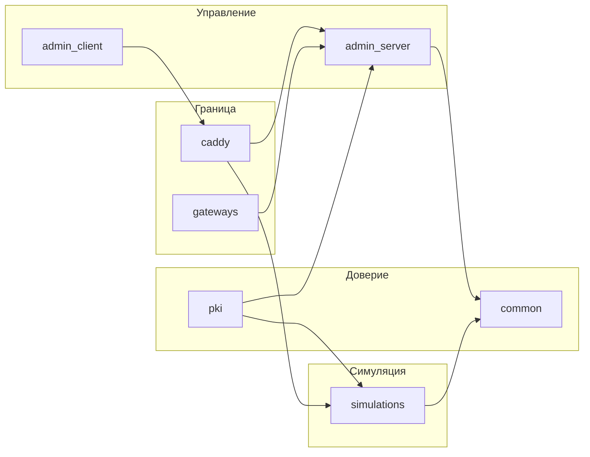

# Каталог src

Настоящий документ показывает, какой каталог за что отвечает. Общие библиотеки лежат в `src/common`. Сервисы не импортируют друг друга напрямую через чужие пакеты: граница между ними проходит через HTTP, Redis и тома сертификатов.

---

## 1. Дерево

---

## 2. Каталоги

| Каталог | Что внутри |
| --- | --- |
| `src/caddy` | `Caddyfile`. Публичный вход на `10.90.10.10` с сертификатом платформы и mTLS. Внутренние имена слушают адреса мостов. `/health` отвечает только на `127.0.0.1` внутри контейнера |
| `src/gateways` | `gemini-gate.js` и `tavily-gate.js`, прокси Cloudflare Workers. В `docker-compose.yml` их нет |
| `src/pki` | Контейнер корневого центра. `bootstrap_pki.py` выпускает сертификаты, `core` хранит ключ корня и подписывает запросы. После выпуска контейнер завершается |
| `src/common` | Код, который подключают несколько сервисов: журнал, клиент Redis, разбор CRL, клиент LLM, мелкие криптографические помощники и параметры TLS для asyncpg |
| `src/admin_server/fastapi` | Административный API: вход, JWT, TOTP, RBAC, журнал аудита, документы RAG |
| `src/admin_server/vectors` | Воркер нарезки документов, запись в MinIO и ChromaDB |
| `src/admin_server/core` | Общий для сервера и воркера журнал |
| `src/admin_client/backend` | Локальный API рабочей станции: загрузка документа, подпись, проверка сертификата, связь с сервером |
| `src/admin_client/frontend` | Интерфейс на React и оболочка Tauri |
| `src/simulations/api` | Единый шлюз банка, инвестиций и цифрового рубля |
| `src/simulations/db` | Три базы и их модели: `bank`, `invest`, `digital_ruble`. Скрипты наполнения лежат в `scripts` каждой базы |
| `src/simulations/workers` | Закрытие дня: `bank_eod`, `invest_eod`, `digital_eod`, общая блокировка `advisory_lock.py` |
| `src/simulations/smart_contracts` | Песочница и контекст контракта цифрового рубля |
| `src/simulations/core` | Подписи квитанций, проверка цепочки, программная проверка анклава и оракула, шифрование полей в таблицах |

---

## 3. Как сервисы связаны

Административный клиент ходит на Caddy. Caddy проверяет клиентский сертификат и передаёт запрос на `admin-server`. К банковскому шлюзу Caddy ходит по внутренним именам.

`root-ca` не обслуживает запросы приложений. Он один раз заполняет тома `admin_certs`, `bank_certs`, `postgres_certs`, `redis_certs`, `minio_certs` и `ca_public`.

Шлюз симуляции и воркеры читают свои базы через роли `bank_app`, `invest_app` и `digital_app`. Пароли этих ролей задаются отдельно от `POSTGRES_PASSWORD`.

Подпись анклава и подпись оракула проверяет код в `src/simulations/core/crypto`. Это проверка подписи в процессе, а не отдельный аппаратный процессор.
